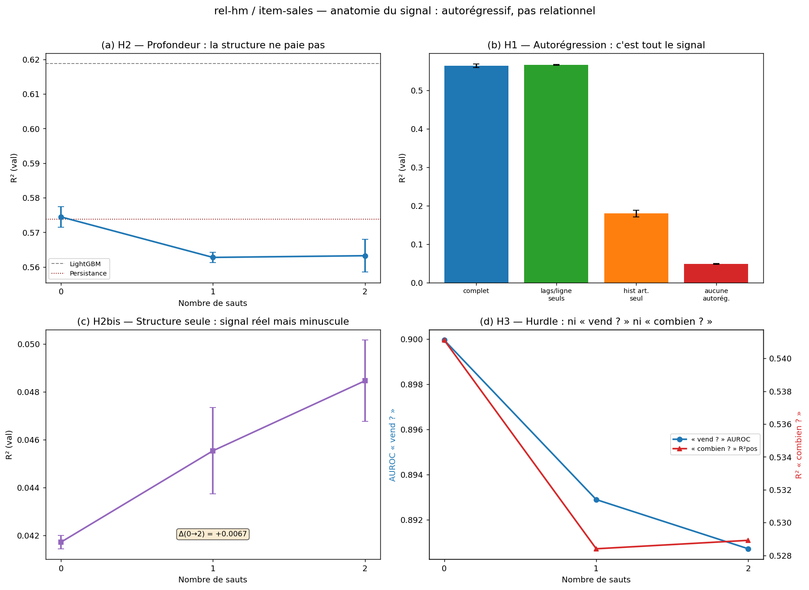

# Does relational structure help forecast sales? GNNs vs flat models on H&M

Do graph neural networks on a relational database beat a flat table with a gradient-boosted model?
This is my part of a five-person project at Télécom Paris (June 2026), run on the [RelBench](https://relbench.stanford.edu) benchmark.
I studied the `rel-hm` dataset and its `item-sales` task: predicting each H&M article's sales over the next 7 days.

The answer here is no.
With the same model, removing all message passing (0 hops) gives the best R², and LightGBM on a flat table beats every graph model.
A controlled ablation shows why: the signal is autoregressive (an article's own past sales), not relational.

**[Team report](docs/team_report.pdf)** (24 pages, my part: sections 3.6 and 4.6) · **[Slides](docs/slides.pdf)**

## Data and task

`rel-hm` has three tables: 105,542 articles, 1.37 M customers and 15.2 M transactions.
Customers and articles form a bipartite purchase graph.
The target is the sales of each article over the next week; about 81% of the values are zero, with a long tail.
Models are trained on weeks from 2019-09-09 to 2020-08-31 and evaluated on the official validation week (2020-09-07).

## Models

- **Persistence**: next week's sales = this week's sales.
- **LightGBM** on a flat table: article attributes, calendar features and sales lags.
- **HeteroSAGE**: a heterogeneous GraphSAGE on the customer-article graph, with a skip connection that feeds the article's own sales lags directly to the prediction head.
  The full graph (12.86 M customer-article pairs) does not fit on a 16 GB P100, so each article keeps 30 of its buyers, drawn at random with a new draw for each seed (1.31 M edges).

## Results

Validation week, GNN rows averaged over 3 seeds:

| Model | MAE | RMSE | R² |
|---|---:|---:|---:|
| Persistence | **0.0472** | 0.4323 | 0.574 |
| LightGBM | 0.0501 | **0.4089** | **0.619** |
| HeteroSAGE, 0 hops | 0.0572 | 0.4320 | 0.575 |
| HeteroSAGE, 1 hop | 0.0584 | 0.4379 | 0.563 |
| HeteroSAGE, 2 hops | 0.0592 | 0.4377 | 0.563 |

Persistence has the best MAE because most targets are zero, and copying last week is hard to beat on those.
LightGBM is better on the large sellers, hence its RMSE and R².

## Why the graph does not help: a controlled ablation

The architecture is fixed and only the information it can see is varied, with 3 seeds per configuration:



1. **The signal is autoregressive.** Removing all sales history (per-row lags and article sales statistics) drops the 2-hop model's R² from 0.563 to 0.049.
2. **The purchase graph carries a real but tiny signal.** Without lags, going from 0 to 2 hops raises R² from 0.042 to 0.049 (+0.007), about 75 times less than the lags.
3. **With the lags, the graph hurts.** Going from 0 to 2 hops lowers R² by 0.011: averaging over an article's buyers dilutes its own `lag1`, which the 0-hop model passes straight to the head.
4. **The hard part is "how much", not "whether".** Split into "will it sell?" and "how much?", the first is almost solved with no graph (AUROC 0.90), and the graph helps neither.
5. **It is not an artefact of the setup.** A denser graph (100 buyers per article, 3.2 M edges), other aggregators (sum, max), down-weighting the second hop, and richer behavioural node features all leave the 0-hop model ahead.

Removing the five categorical article attributes even improves the 2-hop model (+0.007 R²): they describe what an article is, not how it sells, and propagating them adds noise.

**Takeaway.** When the target is dominated by each entity's own history, relational message passing is a noisy detour.
Running a 0-hop control first is a cheap way to detect this before building the graph.
On other tasks of the project (Formula 1 race results, for example), where an entity's outcome depends on the others, the same method found that one hop carries most of the gain.

**Limitations.** One relation and one task, a single validation week, aggregators limited to mean, sum and max, and full-batch training that caps the graph density.

## Repository

| Path | Content |
|---|---|
| `hm_study.ipynb` | Main notebook: data, LightGBM, graph, model, ablations and conclusions, executed end to end |
| `notebooks/` | The original experiment notebooks that produced the ablation results |
| `reports/ablations/` | Results of every ablation run (JSON, one entry per configuration and seed) |
| `docs/` | Team report and slides |

`hm_study.ipynb` retrains the LightGBM baseline and one GNN, then loads the ablation results from `reports/ablations/`.
It ran in about 4 minutes on a P100; each ablation run takes 1 to 2 minutes.

```bash
pip install -r requirements.txt
```

The notebook loads the RelBench data from the local cache (`download=False`): set `download=True` in the `get_task` call for the first run.
Code comments and notebook text are in French.

## Team

ZHENG Tong (`rel-f1` classification), NARANJO RODRIGUEZ Natalia (`rel-amazon` classification), SOUSSOU Koffi Désiré (`rel-amazon` review rating), CIZERON Jules (`rel-f1` regression), RYSZFELD Sacha (`rel-hm` regression).
Supervised by Nikola Simidjievski.
